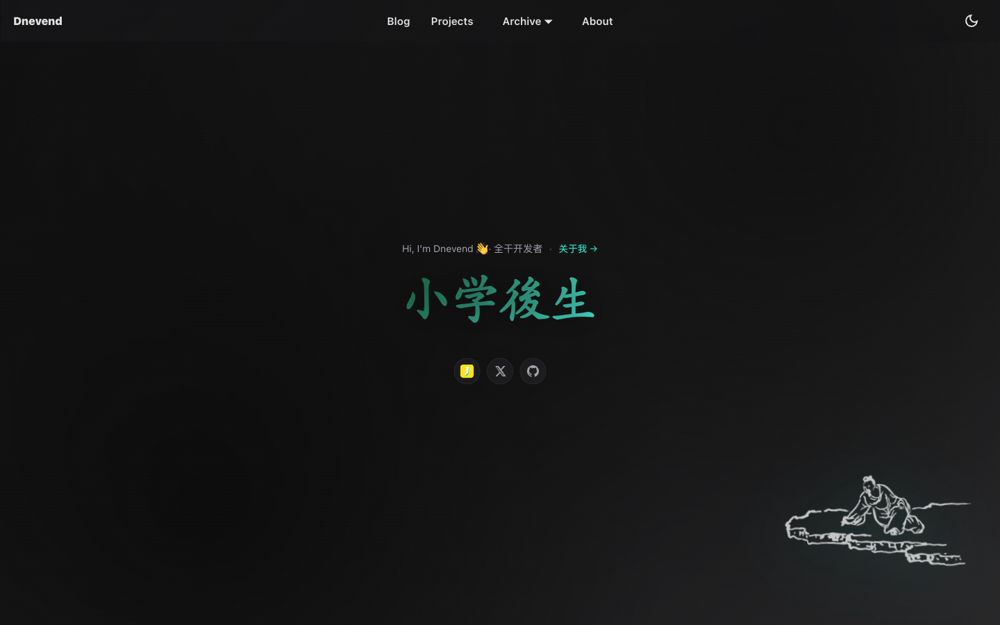
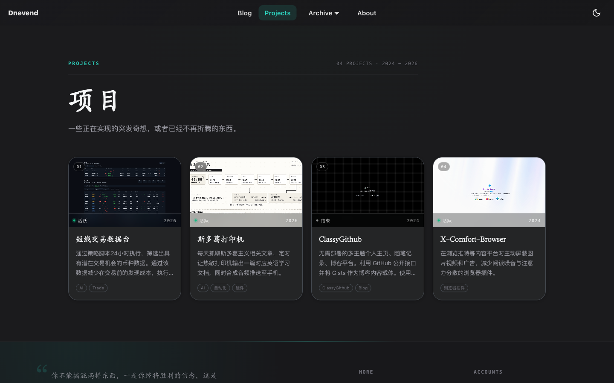
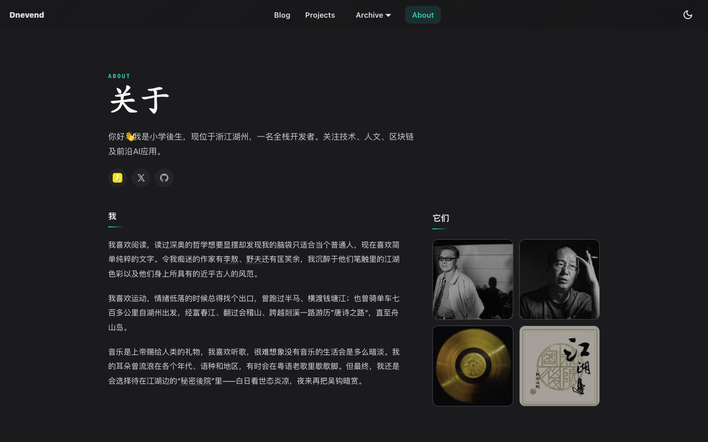

# Dnevend · 小学後生

你好👋我是小学後生，现位于浙江湖州，一名全栈开发者。关注技术、人文、区块链及前沿AI应用。

[Live Site](https://dnevend.site) · [Blog](https://dnevend.site/blog) · [Projects](https://dnevend.site/projects) · [About](https://dnevend.site/about)

## Preview

**Home**

**Projects**

**About**

## License

The source code is licensed under the [MIT License](./LICENSE).

Blog posts, images, and other written content are © 2026 Dnevend and may not be reproduced without permission.
