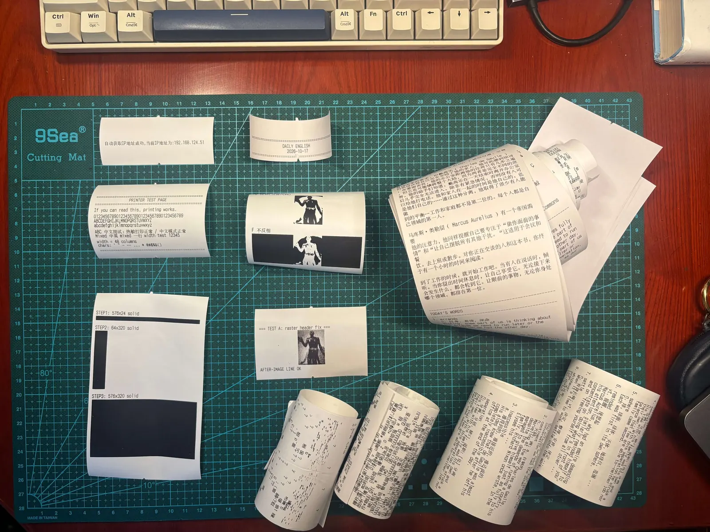
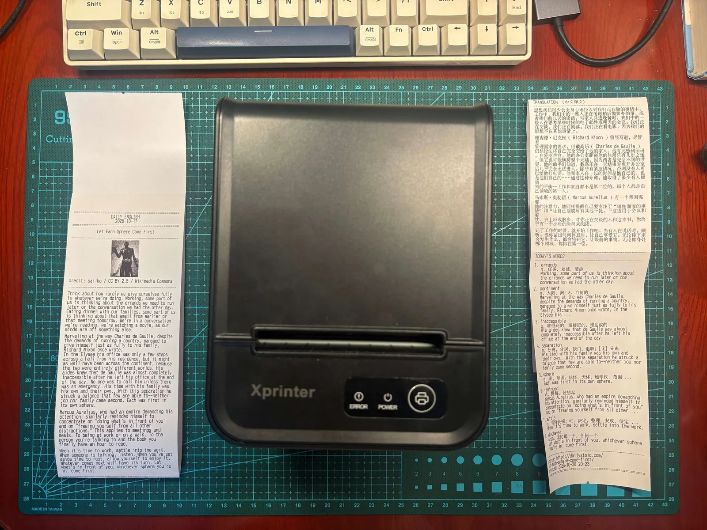
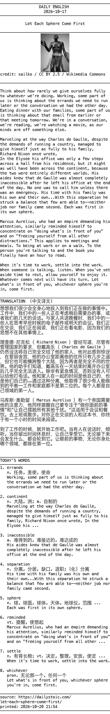

# 斯多葛打印机

书桌一角，近来多了一台旧热敏打印机。二手市场上捡来的，原本是给小饭馆打菜单、给超市打流水的命，如今被我派了个闲差：每天早上九点，自己醒来，吐出一页斯多葛。

纸上是一篇短文，英文在前，译文在后，挑几个生词，配一幅黑白小图。印完了，电脑再把英文念一遍，送进我的 Telegram。纸在桌上，声音在耳边，一日的功课就算开了头。

这台机器从头到尾，是我指挥 AI 搭起来的。写下来，一是记它怎样转起来；二是记中途那些坑——坑是 AI 一个个排查、一个个填平的，我只在几个岔路口拍了板。这条路走下来，恰好能说明白一件事：AI 替我们干了什么，又有什么是它替不了的。

从废纸到成品：

|  |  |
| :-: | :-: |
| 调试时打废的一摞纸 | 最终效果 |

<!-- truncate -->

## 为什么要一台打印机

两个念头，撞在了一处。

其一，我想让 AI 走出那方聊天框。这几年它像个坐堂的先生，你不叩门，它不开口。我想要倒过来：它到了时辰自己起身做事，把结果递到我手上，我连一个窗口都不必打开。这是工程意义上的变化——从「人调 AI」到「AI 定时跑」。

其二，是读英文。屏幕上的字，指头一划就过去了，轻得像没来过。纸不一样：能折，能画，能压在杯底，第二天还在原处等你。热敏打印机还特别省事——不吃墨，不认驱动，开一个 raw 端口（9100）就能直接吃字节，连 SDK 都不用装。

技术选型就是这么定的：**输入是 Daily Stoic 每天一篇的短文**，几百个词，正好够一张 80mm 小票的肚子；**输出是一台走 ESC/POS 的局域网热敏打印机**，把位图字节直接推到它的 9100 端口。

## 每天九点，它做什么

一条流水线，七步，全由定时任务拉起：

1. 抓取：解析 Daily Stoic 的 sitemap，取最新一篇的正文；
2. 清洗：剔掉正文里夹带的推销段落；
3. 翻译：走免费翻译接口，出中文；
4. 生词：按词频表挑出生词，配词典释义和原文例句；
5. 配图：找一张相宜的图，转成黑白点阵；
6. 打印：排成小票，把 ESC/POS 字节流发往打印机；
7. 朗读：edge-tts 合成英文语音，推到 Telegram。

这里有一条设计上的分界，值得单说：**生成内容的每一步，都没用大模型。** 翻译走免费接口，生词靠词频表加离线词典，配图去图库搜。大模型的力气，全花在写这套程序上；程序每天跑起来的时候，不再惊动它。

好处是实打实的：**跑一次几乎零成本**——没有 token，只有打印机吐出的半张纸；**输出稳定**——不担心哪天模型换了脾气，小票的格式跟着变脸。这算是我这段时间的一条心得：能走确定接口的，就别上大模型。大模型贵在「生成」和「判断」，不在「每天按点搬砖」。

节选一段原文：

```text
Think about how rarely we give ourselves fully
to whatever we're doing. Working, some part of
us is thinking about the errands we need to run
later or the conversation we had the other day.
```

机器挑出的生词是 errands、inaccessible、sphere……每个词后面都跟着它在原文里的那一句。比背单词表有意思：你知道它是从哪篇文章里长出来的，而不是标本钉在纸板上。

## 我是怎么用 AI 把它做出来的

我没有一行一行地写，更像一个包工头。但分工是有讲究的：

- **OpenClaw 管调度。** 我把每件活写成一页简报：要什么，边界在哪，什么不许碰。
- **OpenCode 的 worker 干活。** 一件任务一个独立工作区，写完交给另一家族的模型来挑刺，挑不出毛病才合并。请外人来审，是不让它自己给自己判卷。
- **我定方向、验货、拍板。** 换朗读音色时，让 AI 生成几段试听，我一段段听过，自己挑；真机联调，也是我在人与机器之间来回传话。

代码我确实没写几行，但「要什么」这句话，始终是我说的。AI 再快，也猜不到我要的是一张清晨九点的纸，而不是一个更漂亮的网页。**手艺可以外包，心意外包不了。**

## 遇到坑，AI 排查，我拍板

下面这四个坑，没有一个是我自己查出来的。抓日志、读字节流、翻协议文档、试方案，全是 AI 干的。我做的事情只有一件：在岔路口说往哪走。这个分工我看得很重：**AI 能把每个坑查到底，可哪个坑值得填、填成什么样，得由人来定。**

**一个字母的大小写。** 封面图印出来是一长条乱码，中间还平白被切了一刀。AI 起初怀疑旧机器的固件，想先把配图关掉绕过去。这一步我没答应：配图是这张票的门面，可以晚两天，不能砍，一定要出图。AI 只好回头，把自己发出去的字节流逐段对照 ESC/POS 手册，最后查出是位图指令写错了：`GS v` 写成了 `GS V`。小写的 v 是「打印光栅位图」，大写的 V 是「切纸」。打印机何错之有？它一丝不苟地执行了一道错误的命令。

**「No route to host」。** 手动跑一切正常，一挂进定时任务就找不着打印机。AI 一层层往下排，定位到 macOS 的「本地网络」权限：前台进程能连局域网，launchd 拉起的后台进程会被拦在门外。它没去跟系统授权较劲，而是给程序加了一道兜底：连不上时退回系统自带的 nc，直接往 9100 端口发字节。这一处我没插手。绕开问题而不硬碰，本身也是一种工程判断。

**源站断更。** AI 先发现官方接口停在 2023 年，分类页又是 JavaScript 渲染的，于是改为解析 sitemap。后来源站几天不更新，打印机一连三天印了同一篇，它不懂重复，只懂守时。怎么处理是我定的：同一篇不重印；断了更，提醒我一声，别闷着头印。这不是技术问题，是「我想要一台什么样的机器」的问题。

**难听的嗓子。** macOS 自带的 say 念起来字字铿锵，像地铁报站。AI 换成 edge-tts，一口气生成几段不同音色的试听。我一段段听过，挑了一个顺耳的女声，又让它把语速放慢一些。好不好听，是 AI 替不了的判断。

回头看，这四件事里技术含量最高的部分都是 AI 完成的，我做的只是几次选择。但正是这几次选择，决定了最后桌上这张纸的样子。工具越强，执行越不稀缺；稀缺的是审美，是判断，是站得高一点看清「要什么」的那个视角。AI 能一路钻到字节层面，人得站在整件事的上头。

## 几天之后

如今每天早上九点，它准时把一张纸递到我面前，从不迟到，也从不抱怨——这两样美德，它比我有。

机翻的成色，老实说一般，偶尔还错得离谱。讲戴高乐的那篇里有一句，原意是「每个角色在它自己的位置上都是第一位的」，机器译成「每个人都是自己领域的第一人」，意思跑出去老远。可恰恰是这种错，逼我停下来对着原文，把那一句翻来覆去嚼了几遍。译文若是天衣无缝，我大概扫一眼就放过去了。

我从没指望它给我多漂亮的译文。我要的，是它每天把我按在椅子上：读一段英文，查两个词，想一分钟。聊天框做不到的事，一张纸做到了。

还有一层，是后来才想到的。热敏纸不耐久，搁上几年，字迹便一点点淡下去，最后只剩一张白纸。斯多葛派常说 memento mori——记住你终有一死。这台打印机每天印出来的，原就是一页会消失的字。正因为会消失，那天早上读它的那一分钟，才显得要紧。

项目开源，想自己攒一台的，请便：[github.com/Dnevend/daily-stoic-printer](https://github.com/Dnevend/daily-stoic-printer)。



